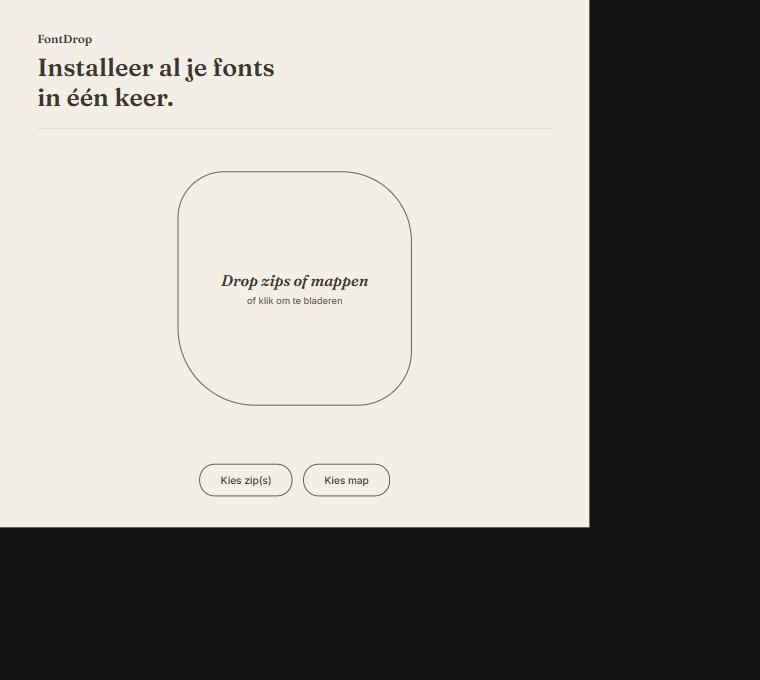

# FontDrop

Install fonts from multiple zips and folders in one go, on Windows, with no admin rights.

Drag your downloads (zips full of subfolders, licenses, previews, OTF and TTF mixed together) into one window. FontDrop extracts everything, recursively finds usable font files, removes duplicates based on the actual font name, and installs what you check.

  
  

## Features

- Drag zips and/or folders into the window, or pick them through a file dialog.
- Extracts zips, including nested zips, into a temporary folder that gets cleaned up afterward.
- Recursively searches for `.otf`, `.ttf`, and `.ttc`. Ignores `__MACOSX`, `._` files, web fonts (`.woff`/`.woff2`/`.eot`), and hidden folders.
- Detects duplicate fonts by the internal font name (family and style, via fontTools), not the file name.
- Prefers OTF by default when a font exists as both OTF and TTF (configurable).
- Shows every style per family, rendered in the font itself, with format and install status. You choose what to install.
- Installs per user: `%LocalAppData%\Microsoft\Windows\Fonts` plus registration in `HKCU\Software\Microsoft\Windows NT\CurrentVersion\Fonts`.
- Summary afterward: installed, skipped (already present), failed (with reason).

## Installing

Download the latest installer from the [Releases page](../../releases), run `FontDrop-Setup-*.exe`, and follow the wizard. No admin rights needed, it installs into your own user profile.
